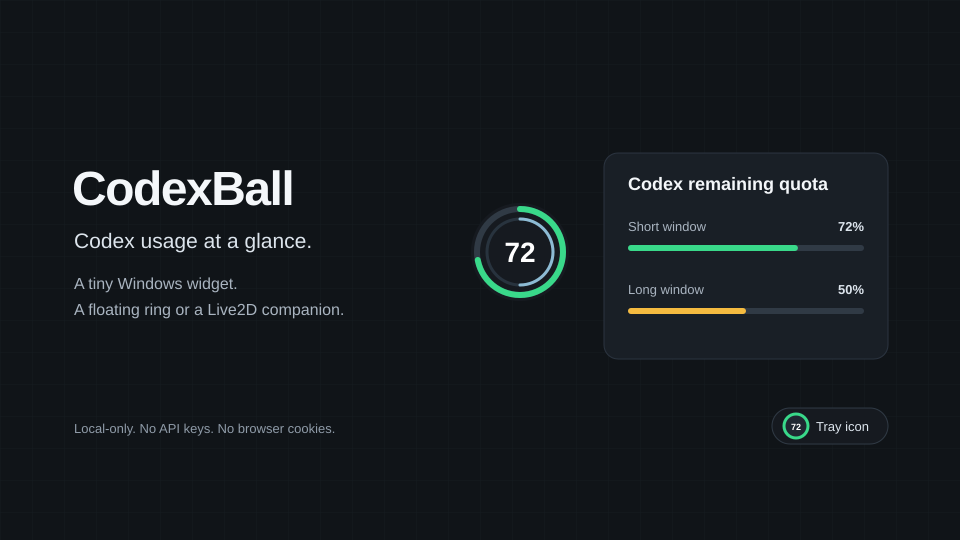

# CodexBall

[](https://github.com/qianfeiqianlan/CodexBall/actions/workflows/build-test.yml)
[](LICENSE)
[](https://github.com/qianfeiqianlan/CodexBall/releases)

CodexBall is a Windows-first desktop widget for keeping an eye on Codex rate-limit status.

Choose a 64 × 64 DIP WPF floating ring or a Live2D companion. Both can hide at a screen edge; the tray icon shows the short-window remaining percentage while Codex is active.



## Features

- Floating always-on-top status ball.
- Unified tray appearance menu: CodexBall ring, Koharu, Haruto, Mao, and Mark.
- Live2D characters with breathing, blinking, pointer tracking, click motions, drag sway, and a minimal usage bar.
- Click-to-toggle single-ring and dual-ring status ball modes.
- System tray icon with refresh, display toggles, launch-at-startup, upgrade, and exit actions.
- Chinese and English UI with immediate switching; follows the operating system UI language by default.
- Optional launch-at-startup toggle (unpackaged builds).
- Edge-hide behavior for a lightweight desktop presence.
- Local settings stored under `%LOCALAPPDATA%\CodexBall\settings.json`.

## Desktop Companion Preview


Global shortcuts: **Alt+H** toggles edge hiding; **Alt+C** cycles through available appearances in tray-menu order and wraps back to CodexBall.

Right-click the system tray icon and open **Appearance / 外观**. Choose **CodexBall** for the 64 × 64 ring, or choose an installed bundled character to enter companion mode automatically. Click the character's head for a reaction, drag to move, and click the thin usage bar for details. The widget itself has no right-click menu.

Haru has been removed. Only the curated bundled appearances are exposed; user model import, reload, and folder access are not currently available in the UI. Existing Haru or unavailable selections fall back to CodexBall. Companion appearances stay visible when Codex is closed; the ring retains its existing activity-based visibility.

## Language

Open the tray menu → **Language / 语言** and choose **Follow system / 跟随系统**, **中文**, or **English**. Changes take effect immediately and are saved. The default follows the operating system UI language at startup: Chinese (`zh`, including traditional Chinese system locales) selects the Chinese UI; other languages select English.

## Edge Hiding

**Alt+H** toggles hiding toward the nearest work-area edge. Distances to left/right are divided by work-area width; distances to top/bottom by work-area height. Hover over the remaining strip to reveal the widget; revealing restores its previous visible position.

## Requirements

For the locally downloaded Koharu, Haruto, Mao, and Mark packs, run `pwsh -File .\scripts\Import-Live2DModels.ps1` and rebuild. See [local model integration](docs/imported-live2d-models.md).

- Windows x64 and an OpenGL 3.3-capable graphics driver for the Live2D preview.
- .NET 9 SDK.
- Codex installed and available from the command line.
- A local Codex login already configured.

CodexBall talks to Codex by launching:

```powershell
codex app-server --stdio
```

It reuses the local Codex login state that the official Codex tooling already uses.

## Build, Test, And Run

```powershell
powershell -ExecutionPolicy Bypass -File .\scripts\Setup-Live2D.ps1
dotnet build
dotnet test
dotnet run --project .\CodexBall.App
```

The setup script fetches the pinned official SDK, Core DLL and license notices for local use. These SDK files are excluded from Git. See [third-party notices](THIRD-PARTY-NOTICES.md). Full `dotnet test` includes real GPU rendering tests; CI excludes tests tagged `Live2DGraphics` because hosted runners may lack OpenGL 3.3.

## Download

For published builds, download the latest `CodexBall-*-win-x64.zip` from GitHub Releases, unzip it, and run `CodexBall.exe`.

Windows may show a SmartScreen warning for unsigned community builds. Check that the zip came from this repository's Releases page before running it.

## Microsoft Store Packaging

In Visual Studio, select `Release | x64` and create the Store package from `CodexBall.Package`. In the package wizard, select only `x64`. The app and bundled Live2D Cubism Core require x64; x86, ARM, ARM64, and AnyCPU packages are unsupported. A previously uploaded x86 package does not change this requirement.

The packaging project restores referenced .NET projects with the publish properties before publishing, including the Visual Studio wizard's separate `obj/wappublish/win-x64` assets directory.

Keep the existing Store identity and publisher when creating an update, and use a package version newer than the previous upload. Check that the generated upload filename contains `_x64_` before submitting it.

## Privacy And Security Boundaries

CodexBall is intentionally small and local:

- It does not ask for API keys.
- It does not read browser cookies.
- It does not read private token files directly.
- It does not call private web APIs.
- It does not run a backend service or database.
- It does not attempt to bypass, increase, or alter Codex rate limits.
- It only displays rate-limit information returned by the local Codex app server.

The app stores its own lightweight UI preferences locally in `%LOCALAPPDATA%\CodexBall\settings.json`.

## Current Scope

CodexBall is an MVP desktop utility. The project is currently Windows-first because the UI is implemented with WPF. Cross-platform UI support, installers, charts, and richer usage analytics are intentionally outside the initial scope.

## Development Notes

The project is split into:

- `CodexBall.App`: WPF UI, tray integration, window behavior, settings, and view models.
- `CodexBall.Core`: Codex process startup, JSON-RPC, protocol parsing, and formatting helpers.
- `CodexBall.Tests`: protocol parsing, formatting, companion contracts, quota reactions, and edge-hide geometry.
- `CodexBall.App.Tests`: WPF/player integration, appearance cycling, language resolution/persistence, and real GPU rendering.

Current behavior and remaining goals: [companion requirements](docs/desktop-companion-requirements.md). Rendering architecture and limitations: [Live2D preview](docs/live2d-technical-preview.md). Developer guidance: [AGENTS.md](AGENTS.md).

Keep Codex protocol details in `CodexBall.Core`; WPF code should consume view models and core models.

## License

CodexBall is released under the MIT License.
